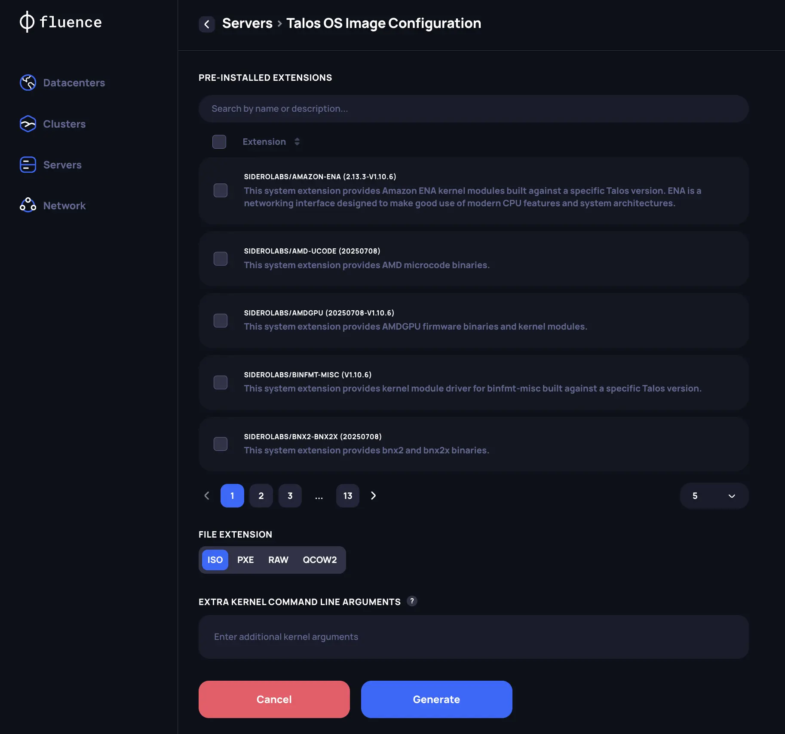
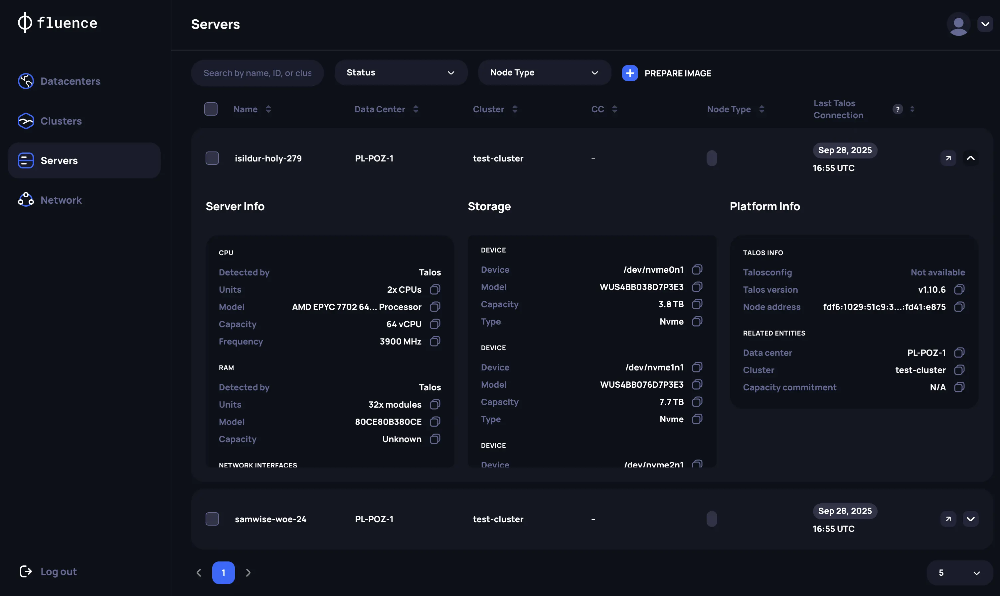

# Add servers

Fluence supports Talos Linux as the server OS. Talos Linux supports the [SideroLink protocol](https://docs.siderolabs.com/talos/v1.11/networking/siderolink), which lets the Provider Application manage the OS and the clusters remotely through the Talos API.

## Generate a Talos Linux image

Use only Talos Linux images that the Provider Application generates. The application cannot manage servers that run other images.

1. In the Provider Application, open **Servers** and generate a new Talos Linux image.
2. Under system extensions, add `amd-ucode` for AMD servers or `intel-ucode` for Intel servers. System extensions are OS drivers that add functions to Talos Linux, for example for network or storage setup. The CPU microcode extension gives the best server performance.
3. If the private network for the Talos and Kubernetes APIs has no DHCP server, add the network settings as extra kernel command line arguments. See the [`ip` kernel argument](https://docs.siderolabs.com/talos/v1.11/reference/kernel#ip) in the Talos documentation for examples, and [Network requirements](./overview.md#network-requirements) for the private network.
4. Choose the image type for installation on bare metal. If most of your servers can use the same image, with the same extensions and kernel arguments, use [PXE boot](https://docs.siderolabs.com/talos/v1.11/platform-specific-installations/bare-metal-platforms/pxe).

## Check that the servers are connected

Install the image on your servers. If the private network is configured correctly, the new servers appear on the **Servers** page. A few minutes later, the application shows the hardware that Talos Linux detected on each server.

The **Last Talos Connection** field shows when the application last reached the server. The application connects to each server every 2 minutes.

You can also check the Talos Linux and SideroLink status, server details, and logs through the server's IPMI console.

To rename a server, do it before you add the server to a cluster. After that, the name cannot be changed.
