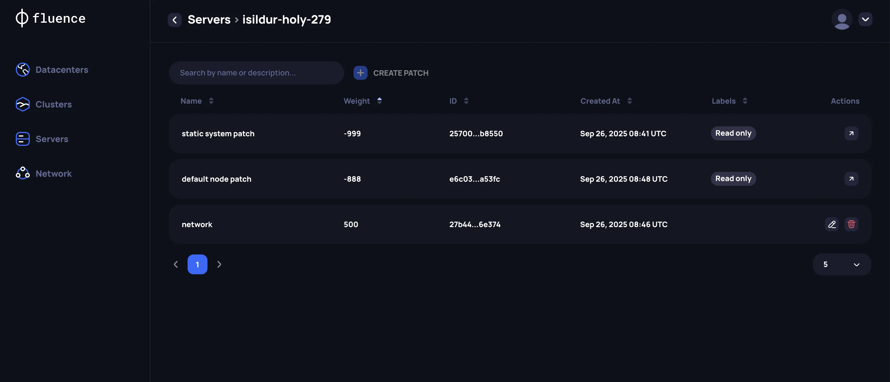

# Create a Kubernetes cluster

Servers that boot a Talos Linux image from the Provider Application start in maintenance mode. The servers stay in maintenance mode until you configure Talos Linux to run Kubernetes workloads.

## Choose the cluster settings

Open **Clusters** in the Provider Application and create a cluster. Set these parameters:

1. **Data center.** A cluster contains servers from one physical data center.
2. **VLAN ID for private networking.** Optional. Set it if your internal traffic for the Talos and Kubernetes APIs uses a VLAN.
3. **Kubernetes roles.** For each server, choose its [Kubernetes role](https://kubernetes.io/docs/concepts/architecture/nodes/). Use an odd number of control plane nodes. For a stable cluster, use at least three control plane nodes and place them in different racks or cabinets.
4. **Workload interface.** For each server, choose the network interface for Fluence customers' workloads. It must be 10 GbE or faster. 100 GbE is recommended.
5. **Talos disk.** For each server, choose the disk for Talos Linux. Use an SSD or NVMe RAID 1 with at least 100 GB free. The [hardware requirements](./overview.md#hardware-requirements) recommend 200 GiB free.
6. **Workload disks.** For each server, choose the directly attached disks for customer workloads. Do not use RAID on workload disks. Fluence replicates the data itself. The Talos disk can also hold workloads, but this is not recommended. If one disk holds both Talos Linux and workloads, do not use RAID on it.
7. **Talos patch.** For each server, configure a [Talos patch](https://docs.siderolabs.com/talos/v1.11/configure-your-talos-cluster/system-configuration/patching). The application creates default patches for disks and general machine settings. Talos Linux does not know your data center's network layout, so describe each network interface for Talos and Kubernetes management yourself. See [machine network settings](https://docs.siderolabs.com/talos/v1.11/configure-your-talos-cluster/system-configuration/patching#machine-network) in the Talos documentation and the [example patch](#example-talos-patch) below.

:::danger Keep two control plane nodes healthy

A cluster needs at least two healthy control plane nodes. If all control plane nodes become unavailable, for example because of a private network or hardware failure, the Kubernetes cluster breaks and cannot restore its state.

:::

:::danger Ignore workload interfaces in the patch

In the Talos patch, set `ignore: true` for every network interface that carries Fluence customers' workloads.

:::

:::danger Avoid the default Kubernetes subnets

Kubernetes uses `10.244.0.0/16` for pods and `10.96.0.0/12` for services by default. Make sure that the Talos management network does not overlap these ranges, or set other pod and service subnets in the Talos patch, as in the example below.

:::



## Create the cluster

After you set all parameters, create the cluster. The **Clusters** section shows the setup progress. During setup, the Provider Application:

1. Configures the servers with the disk and network settings you chose.
2. Joins the Talos Linux nodes into one cluster and starts Kubernetes.
3. Installs and configures the Fluence services that run customer workloads and check server availability.

## Example Talos patch

This example is for a server with one bonded management interface and one workload interface:



The Talos patch for this server:

```yaml
cluster:
  network:
    podSubnets:
      - 10.210.0.0/16
    serviceSubnets:
      - 10.112.0.0/12
machine:
  network:
    interfaces:
      # management
      - interface: bond0
        dhcp: false
        addresses:
          - 10.2.100.10/24
        routes:
          - network: 0.0.0.0/0
            gateway: 10.2.100.1
        bond:
          mode: 802.3ad
          xmitHashPolicy: layer3+4
          interfaces:
            - enp6s18
            - enp6s19

      # workload
      - interface: enp6s20
        ignore: true
```
