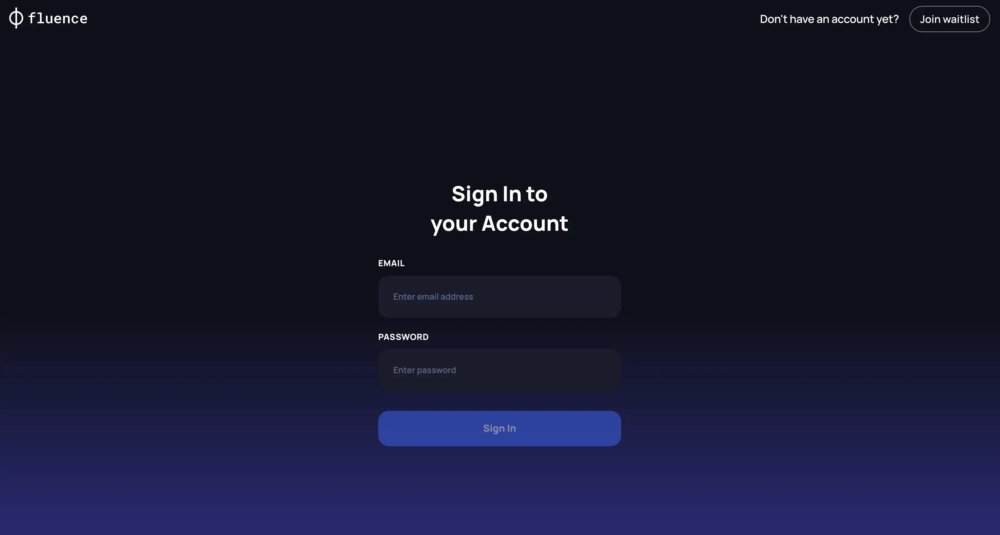

# Log in to the Provider Application

## Get approved

Fluence Cloud works only with approved providers that operate Tier 3 or Tier 4 certified data centers. Before you join, the Fluence team reviews your application, and you complete a KYB (know your business) review.

To apply, contact the Fluence team through one of the [official channels](https://linktr.ee/fluencenetwork).

## Sign in

After you pass the KYB review, the Fluence team sends you the credentials for the [Provider Application](https://providers.fluence.network/). Sign in with them.

