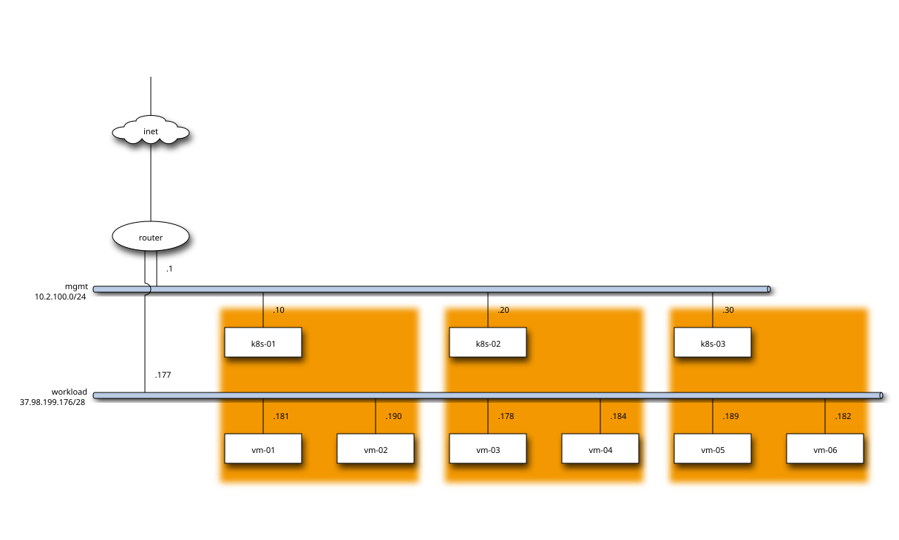

# Connect servers to Fluence

Data center operators connect bare metal servers to Fluence Cloud through the [Fluence Provider Application](https://providers.fluence.network/). The Fluence team develops and hosts the application. With it, you:

- Install and manage Talos Linux, the supported server OS.
- Create and manage Kubernetes clusters on servers that run Talos Linux.
- Install, configure, and update the Fluence services that run in each cluster.
- Configure network interfaces, VLANs, and private subnets for Talos Linux and Kubernetes.
- Assign public IP subnets to clusters, so that Fluence customers' virtual machines get public IP addresses.

To get access, see [Log in to the Provider Application](./login.md).

## Data center requirements

- Tier 3 or Tier 4 certification.
- ISO 27001, SOC 2 Type 1, or SOC 2 Type 2 certification is not required, but Fluence prefers data centers that have one or more of them.

## Hardware requirements

Servers must be bare metal.

| Component | Requirement |
|---|---|
| CPU | AMD EPYC or Ryzen Zen 2 or newer, or Intel Xeon Cascade Lake or newer. Unrestricted Turbo Boost on. At least 32 vCPU per CPU. |
| RAM | DDR4 or newer. At least 4 GiB per 2 vCPU. |
| Storage for customer workloads | Directly attached SSD or NVMe, without RAID. At least 25 GiB per 2 vCPU. |
| Storage for the host OS | Recommended: a dedicated RAID 1 of two NVMe drives with at least 200 GiB free. Use two different drive models, so that both drives are less likely to fail at the same time. |
| Network interface for Talos Linux and Kubernetes | 1 GbE or faster |
| Network interface for customer workloads | 10 GbE minimum, 100 GbE or faster recommended |

## Network requirements

Each server uses two networks:

- The management subnet carries traffic for the host OS (Talos Linux) and the Kubernetes APIs. It must allow egress to the internet, supports bonding, and can use a VLAN.
- The workload subnet carries Fluence customers' traffic. It must be isolated from your internal networks and reach only the internet. The workload subnet cannot be bonded but can use a VLAN.

The diagram shows one possible network layout in a data center. The orange area is one physical server.
