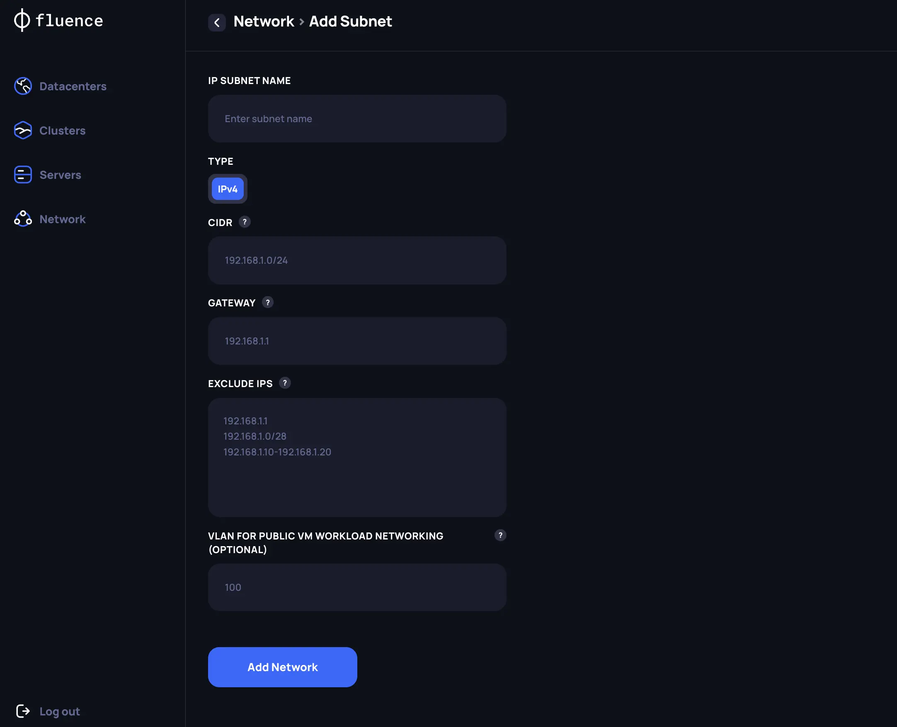

# Add an IP subnet

A cluster needs at least one public IPv4 subnet before it can run Fluence customers' workloads. You configure the subnet in your data center so that every server in the data center can reach it. The Fluence software then routes addresses from the subnet to the right servers.

## Register the subnet

Open **Network** in the Provider Application and create a subnet with these details:

1. **CIDR.** The range of IP addresses in the subnet.
2. **Gateway.** The gateway address.
3. **Exclude IPs.** Addresses that Fluence must not allocate.
4. **VLAN ID for public networking.** Optional. Set it if public traffic in your data center uses a VLAN.

## Assign the subnet to a cluster

After you create the subnet, select it in the list on the **Network** page and assign it to a Kubernetes cluster.
